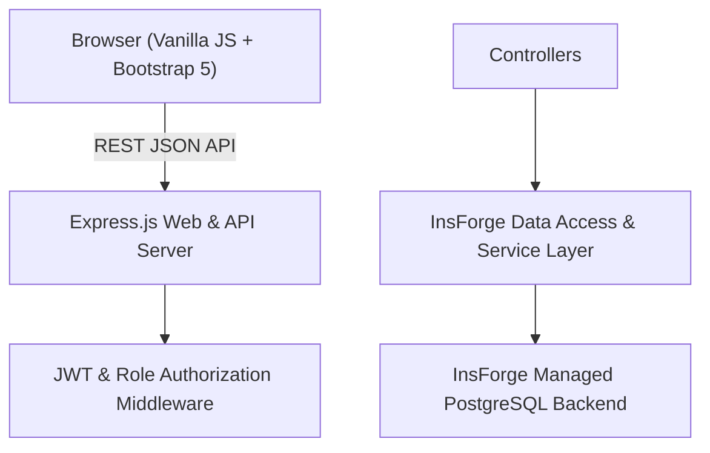
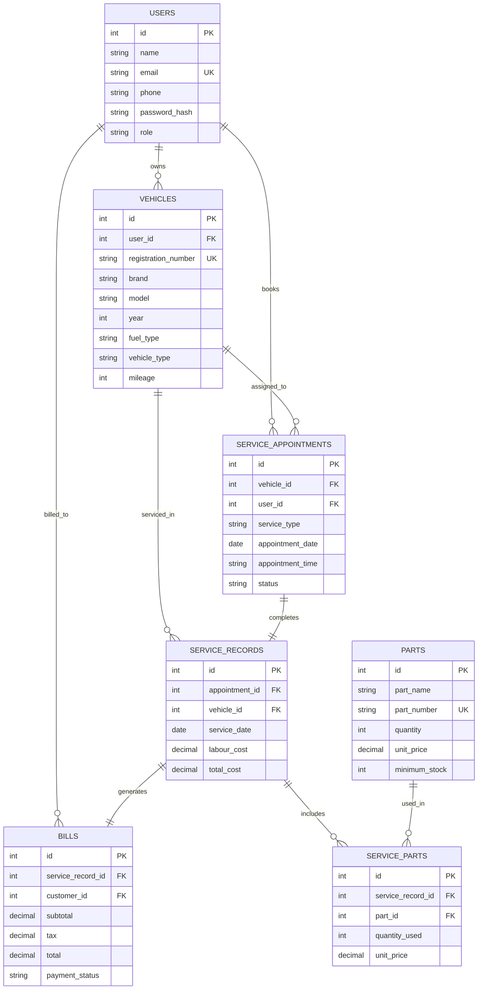
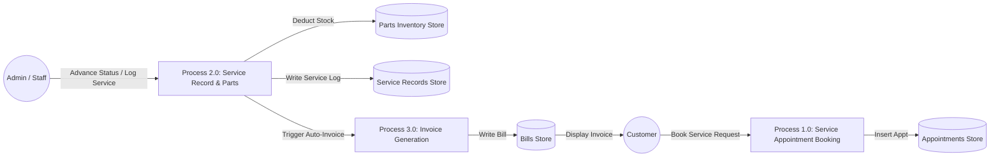
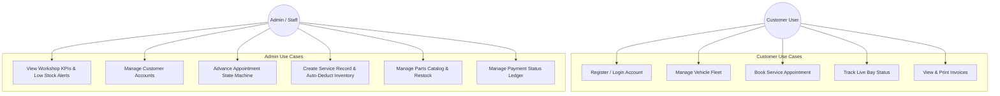
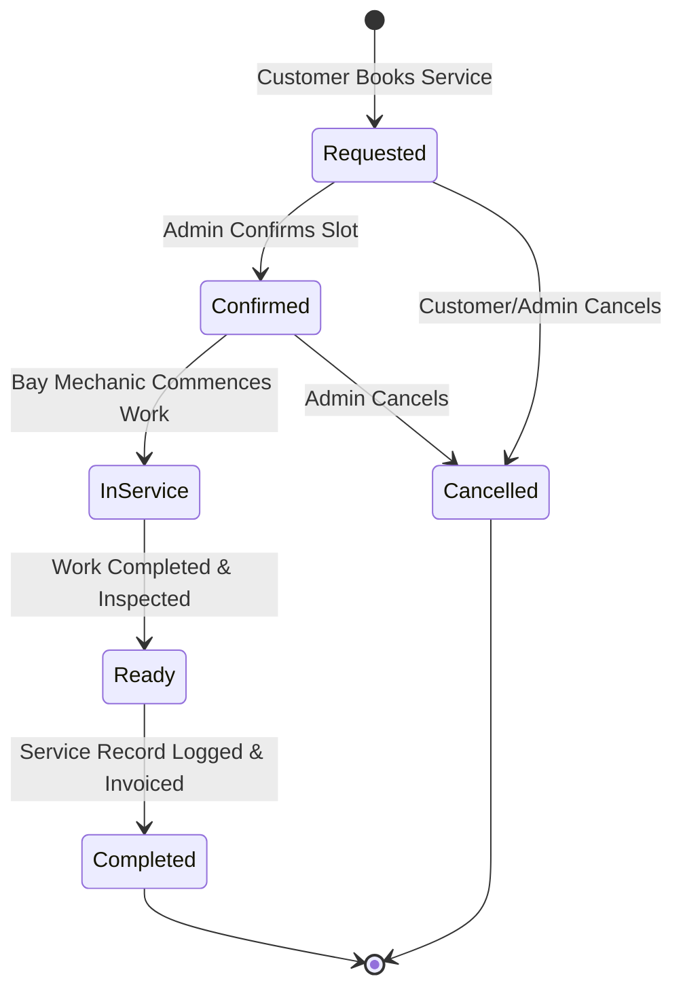

# Chapter 4 — System Design & Diagrams

## 4.1 System Architecture Diagram

---

## 4.2 Entity-Relationship (ER) Diagram

---

## 4.3 Data Flow Diagram (DFD Level 1)

---

## 4.4 Use Case Diagram

---

## 4.5 Appointment State Machine Workflow

